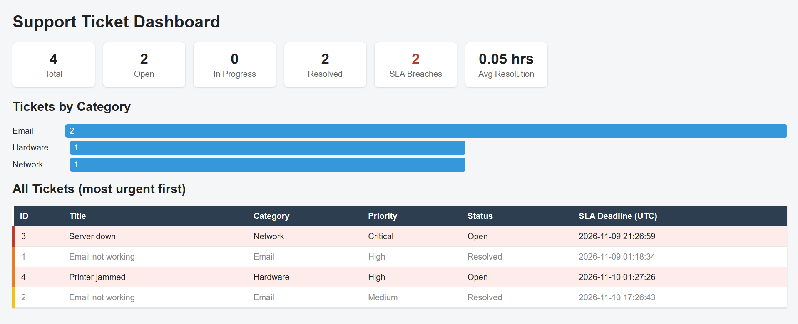

# Support Ticket Manager

A command-line IT support ticket system built with Python and SQLite. Tickets are served in order of urgency using a heap-based priority queue, every ticket gets an automatic SLA deadline based on its priority, and an HTML/CSS dashboard shows the overall picture.

## Features

- Create tickets with a title, category and priority (Critical, High, Medium, Low)
- Automatic SLA deadline calculation (Critical: 4 hours, High: 8 hours, Medium: 24 hours, Low: 72 hours)
- Get the next ticket to work on: the most urgent one comes first, and ties go to the earliest deadline
- Resolve tickets and record the resolution time
- SQL analytics reports: tickets per category, average resolution time, SLA breaches
- **HTML/CSS dashboard** with summary cards, a tickets-by-category bar chart, and a priority-coloured ticket table that highlights overdue tickets
- Input validation for empty fields and invalid priorities
- Persistent storage in SQLite

## Dashboard



The dashboard is generated by the app as a standalone `dashboard.html` file styled with `style.css`. It shows:

- Summary cards: total, open, in-progress and resolved tickets, SLA breaches, and average resolution time
- A bar chart of tickets per category (bar widths are calculated relative to the largest category and set with inline CSS)
- A table of all tickets sorted by urgency, with a coloured strip for each priority level and a light-red background for overdue tickets
- User-entered text is escaped with `html.escape()` before being written to the page

## Tech Stack

- **Language:** Python 3
- **Database:** SQLite (`sqlite3` module)
- **Data structure:** Min-heap (`heapq`)
- **Frontend:** HTML and CSS (generated from Python)
- **Tools:** Git, GitHub, VS Code

## How It Works

**Priority queue.** Open tickets are kept in a min-heap of `(priority, sla_deadline, ticket_id)` tuples. Python compares tuples left to right, so the lowest priority number (most urgent) is served first, and ties are broken by the earliest deadline. Insert and extract both take O(log n), which is faster than re-sorting a list every time a ticket arrives.

**Lazy deletion.** A ticket can be resolved while it is still in the heap. Instead of searching the heap to remove it (O(n)), the program checks the ticket's status in the database when it is popped and skips it if it is no longer open.

**SLA tracking.** Each ticket's deadline is calculated at creation time from its priority. Timestamps are stored in UTC so they can be compared safely in SQL. A ticket breaches its SLA if it is still open past its deadline, or was resolved after it.

**Safe SQL.** All queries use parameterized placeholders (`?`) to prevent SQL injection.

**Report generation.** `report.py` runs SQL queries, builds the HTML page as a string with the results, and writes it to `dashboard.html`. Styling lives in a separate `style.css` to keep content and presentation apart.

## Project Structure

```
ticket-manager/
├── main.py       # command-line menu
├── db.py         # database setup and SQL report queries
├── tickets.py    # ticket logic and heap priority queue
├── report.py     # generates the HTML dashboard
├── style.css     # dashboard styling
├── dashboard.png # dashboard screenshot
└── README.md
```

`tickets.db` and `dashboard.html` are generated when the app runs, so they are listed in `.gitignore`.

## Database Schema

```sql
CREATE TABLE tickets (
    id INTEGER PRIMARY KEY AUTOINCREMENT,
    title TEXT NOT NULL,
    category TEXT NOT NULL,
    priority INTEGER NOT NULL,        -- 1=Critical, 2=High, 3=Medium, 4=Low
    status TEXT NOT NULL DEFAULT 'Open',
    created_at TEXT NOT NULL,
    sla_deadline TEXT NOT NULL,
    resolved_at TEXT
);
```

## How to Run

1. Make sure Python 3 is installed.
2. Clone the repository:
   ```
   git clone https://github.com/realdivyamgupta/ticket-manager.git
   cd ticket-manager
   ```
3. Start the app (the database is created automatically on first run):
   ```
   python main.py
   ```

## Menu Options

```
1. Create ticket
2. View all tickets
3. Get next ticket to work on
4. Resolve ticket
5. Show reports
6. Generate HTML dashboard
7. Exit
```

## What I Learned

- Using a heap as a priority queue and why it beats repeated sorting
- Designing a relational table and writing aggregate SQL queries (`GROUP BY`, `AVG`, date comparisons)
- Handling timestamps consistently with UTC
- Generating HTML and CSS from Python, and escaping user input to avoid injection
- Debugging Python indentation and structuring a project across multiple modules
- Using Git and GitHub with small, focused commits

## Future Improvements

- Agent assignment and login
- Email alerts before an SLA breach
- Web version using Flask
- Unit tests for SLA and heap logic